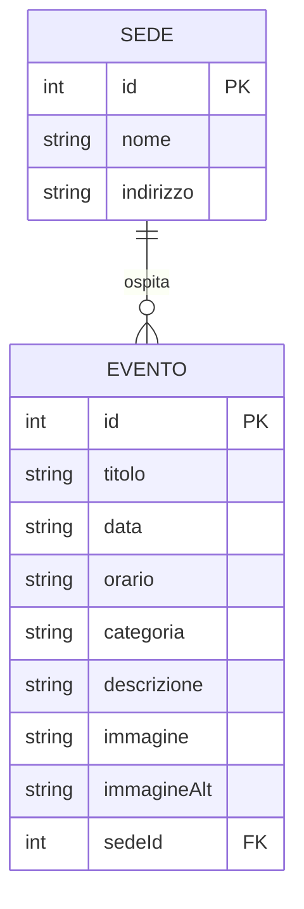

# Scheda dati

## Entità: Sede

| Campo | Tipo | Esempio |
|---|---|---|
| `id` | numero intero | `1` |
| `nome` | stringa | `"Officina Nord — Sede centrale"` |
| `indirizzo` | stringa | `"Corso Duca degli Abruzzi 24, Torino"` |

**Chiave primaria:** `id`, numero univoco e stabile nell’entità.

## Entità: Evento

| Campo | Tipo | Esempio |
|---|---|---|
| `id` | numero intero | `1` |
| `titolo` | stringa | `"Lettere in movimento"` |
| `data` | stringa, formato `AAAA-MM-GG` | `"2026-06-12"` |
| `orario` | stringa, formato `HH:MM` | `"10:00"` |
| `categoria` | stringa | `"Incontro"` |
| `descrizione` | stringa | `"Un incontro su tipografia, ritmo e comunicazione visiva."` |
| `immagine` | stringa, percorso del file | `"assets/lettere-in-movimento.svg"` |
| `immagine_alt` | stringa | `"Lettere geometriche disposte su una griglia"` |
| `sede_id` | numero intero | `1` |

**Chiave primaria:** `id`, numero univoco e stabile nell’entità.

## Relazione

Una sede può ospitare più eventi; ogni evento si svolge in una sede.  
`Evento.sede_id` fa riferimento a `Sede.id`.

